# KIYU — System Design Specification

> Dokumen ini adalah **spesifikasi desain sistem KIYU**.
>
> Tujuan dokumen: menjadi **single source of truth untuk business flow, domain model, role, state, relationship antar-entitas, dan business rules**.
>
> Dokumen ini **sengaja tidak membahas technology stack, framework, package, ORM, database engine, deployment, atau detail implementasi teknis**.
>
> Bila terdapat konflik antara implementasi dan dokumen ini, **business behavior dalam dokumen ini harus menjadi acuan**, kecuali requirement telah direvisi secara eksplisit.

---

# 1. System Overview

## 1.1 Key Design Decision — Online Patient Must Still Pass Reception

Pasien yang mengambil intake melalui ONLINE tetap melalui meja reception.

Kiosk bukan pengganti reception. Kiosk hanya digunakan untuk:

```text
mengonfirmasi bahwa pasien online sudah datang
```

Setelah self check-in berhasil:

```text
Visit = WAITING
      ↓
Registration QueueTicket dibuat
      ↓
Reception Queue
      ↓
Receptionist CALL NEXT
      ↓
Patient goes to Reception Desk
      ↓
Registration
```

Karena itu:

```text
Online booking
    ≠
Reception queue
```

Dan:

```text
Physical check-in
    =
titik yang membuat online patient eligible masuk reception queue
```

Pasien online yang belum datang tidak boleh dipanggil oleh reception.

---


KIYU adalah sistem manajemen **antrian dan perjalanan pelayanan pasien pada fasilitas kesehatan**.

Sistem memodelkan perjalanan pasien dari:

```text
Intake
  ↓
Reception / Registration
  ↓
Clinical Queue
  ↓
Workflow
  ↓
Service
  ↓
Visit Completion
```

Terdapat tiga channel intake utama:

```text
ONLINE
KIOSK
MANUAL
```

Ketiga channel tersebut pada akhirnya masuk ke domain yang sama:

```text
Visit
  ↓
QueueAcquisition
  ↓
Reception / Registration
  ↓
QueueTicket
  ↓
Workflow / WorkflowStep
  ↓
Clinical Queue
```

## 1.2 Tujuan utama sistem

Sistem harus mampu:

- membuat kunjungan pasien;
- menerima pasien melalui online, kiosk, atau manual;
- mengatur antrian reception;
- melakukan registrasi pasien;
- meneruskan pasien ke workflow pelayanan;
- mengelola antrian pada setiap station;
- mengatur prioritas;
- memindahkan antrian antar-station;
- melakukan referral antar-department;
- menyimpan riwayat event dan perubahan bisnis penting;
- menjaga konsistensi state pada operasi yang bersifat concurrent.

## 1.3 Prinsip desain inti

### Visit

`Visit` merepresentasikan:

> **satu kunjungan pasien ke satu department.**

### QueueAcquisition

`QueueAcquisition` merepresentasikan:

> **intake/antrian masuk menuju proses reception.**

Ia bukan lifecycle antrian pelayanan klinis.

### QueueTicket

`QueueTicket` merepresentasikan:

> **satu posisi antrian untuk satu workflow step.**

Satu Visit dapat menghasilkan beberapa QueueTicket selama perjalanan workflow.

### Workflow

`Workflow` mendefinisikan:

> **urutan proses pelayanan untuk suatu department.**

### WorkflowStep

`WorkflowStep` mendefinisikan:

> **satu tahap dalam workflow yang dilayani pada suatu station.**

---

# 2. Core Domain Concept

Relasi konsep utama:

```text
Patient
   │
   └──< Visit >── Department
          │
          ├── Workflow
          │      └──< WorkflowStep >── Station
          │
          ├── QueueAcquisition
          │
          └──< QueueTicket >── Station
                     │
                     └──< QueueEvent
```

Entitas inti:

```text
Department
Station
Patient
Visit
QueueAcquisition
QueueTicket
Workflow
WorkflowStep
QueueEvent
QueueCounter
VisitCounter
Referral
AuditLog
```

---

# 3. Actor & Role Model

## 3.1 Actor categories

Aktor sistem secara fungsional dapat dikelompokkan menjadi:

| Actor | Tanggung jawab utama |
|---|---|
| Patient | Membuat kunjungan online, melakukan check-in, melihat kunjungan dan antrian miliknya |
| Receptionist | Mengelola intake, memilih department, memanggil antrian reception, mencari/membuat pasien, menyelesaikan registration |
| Clinical User | Mengelola QueueTicket pada station yang ditugaskan |
| Administrator | Mengelola konfigurasi dan operasi administratif yang membutuhkan privilege |
| Kiosk | Channel intake mandiri untuk membuat acquisition |
| Public Queue Display | Menampilkan informasi antrian publik tanpa PII |

> **Catatan desain:** source implementation plan secara eksplisit menyebut `PATIENT`, `ADMIN`, dan `RECEPTIONIST`, serta menyebut `clinical user` sebagai kelompok pengguna. Detail katalog role klinis seperti `DOCTOR`, `NURSE`, atau role klinis lain belum dinormalkan sebagai enum role dalam source specification ini. Role tambahan harus ditetapkan melalui requirement terpisah dan tidak boleh diasumsikan oleh implementasi.

## 3.2 Patient

Patient dapat:

```text
Create online visit
      ↓
Check-in
      ↓
View own visit
      ↓
View own queue
```

Patient hanya boleh mengakses resource miliknya sendiri.

Invariant:

```text
Patient A
   X
Patient B's Visit
```

## 3.3 Receptionist

Receptionist bertugas pada context reception.

Receptionist:

```text
Choose Department
      ↓
Backend validates access
      ↓
Backend resolves active Registration Station
      ↓
Reception operations
```

Receptionist tidak boleh memilih station secara bebas.

Receptionist dapat:

- melihat department yang dapat diakses;
- membuat manual acquisition;
- melihat acquisition reception;
- memanggil next reception queue;
- mencari pasien;
- membuat atau menghubungkan patient saat registration;
- menyelesaikan registration;
- menghasilkan clinical QueueTicket berikutnya.

## 3.4 Clinical User

Clinical user memproses queue pada station yang ditugaskan.

Context user:

```text
User
 ├── Department
 └── Station
```

Sebelum melakukan operasi pada queue, sistem harus memeriksa:

```text
Assigned station exists
        AND
Station active
        AND
Station belongs to assigned department
        AND
Ticket station matches assigned station
        AND
Role/business operation is permitted
```

## 3.5 Administrator

Administrator memiliki kemampuan untuk melakukan operasi administratif yang bersifat sensitive.

Contoh operasi:

```text
Priority modification
Administrative modification
Sensitive state change
Provisioning / role management
```

Detail permission administratif harus ditentukan oleh policy bisnis yang berlaku.

---

# 4. Organizational Structure

Struktur organisasi operasional:

```text
Department
   │
   ├── Stations
   │      ├── Registration
   │      ├── Nurse
   │      ├── Doctor
   │      ├── Laboratory
   │      ├── Pharmacy
   │      └── Billing
   │
   └── Workflow
          │
          ├── WorkflowStep 1
          ├── WorkflowStep 2
          ├── WorkflowStep 3
          └── ...
```

## 4.1 Department

Department adalah unit pelayanan.

Contoh konsep:

```text
Department
 ├── code
 ├── name
 └── active/inactive
```

Department memiliki workflow dan station.

## 4.2 Station

Station adalah titik pelayanan fisik/logis.

Attribute konseptual:

```text
id
department_id
name
code
type
queue_prefix
is_active
```

Station type yang disebut dalam baseline:

```text
REGISTRATION
NURSE
DOCTOR
LABORATORY
PHARMACY
BILLING
```

## 4.3 Registration Station

Setiap active Workflow baseline harus memiliki tepat satu active registration step yang resolvable ke station bertipe:

```text
REGISTRATION
```

Resolution:

```text
Workflow
   ↓
active WorkflowStep
   ↓
station exists
   ↓
station.type = REGISTRATION
```

Jika:

```text
0 registration step
```

atau:

```text
>1 active registration step
```

maka workflow dianggap invalid untuk intake.

---

# 5. Patient Model

Patient merupakan identitas pasien di dalam domain pelayanan.

Patient dapat ada tanpa user account.

Konsep:

```text
User 1 ───── 0..1 Patient
```

Artinya:

```text
User
  └── optional Patient

Patient
  └── optional User
```

Patient identity dapat diketahui:

- sejak sebelum visit;
- saat online intake;
- saat registration untuk manual/kiosk intake.

---

# 6. Visit Model

`Visit` adalah pusat perjalanan pelayanan.

Konsep:

```text
Patient
   │
   └── Visit
         ├── Department
         ├── Workflow
         ├── Priority
         ├── Intake Channel
         └── QueueTickets
```

## 6.1 Atribut konseptual

```text
id
patient_id?
department_id
workflow_id
visit_number
priority
intake_channel
status
online_active_key?
registered_by?
checked_in_at?
registered_at?
completed_at?
created_at
updated_at
```

`patient_id` nullable karena:

```text
MANUAL → patient belum diketahui
KIOSK  → patient belum diketahui
```

## 6.2 Visit status

```text
AWAITING_CHECKIN
WAITING
IN_PROGRESS
COMPLETED
CANCELLED
```

## 6.3 Visit lifecycle

Online:

```text
AWAITING_CHECKIN
      ↓
WAITING
      ↓
IN_PROGRESS
      ↓
COMPLETED
```

General clinical path:

```text
WAITING
   ↓
IN_PROGRESS
   ↓
COMPLETED
```

Check-in:

```text
AWAITING_CHECKIN → WAITING
```

Clinical service start:

```text
WAITING → IN_PROGRESS
```

Final workflow completion:

```text
IN_PROGRESS → COMPLETED
```

### Important rule

Reception registration completion:

```text
DOES NOT mean
Visit → IN_PROGRESS
```

Setelah registration selesai:

```text
Visit = WAITING
```

---

# 7. Intake Channel Model

Tiga intake channel:

```text
ONLINE
KIOSK
MANUAL
```

Masing-masing mempunyai entry behavior berbeda tetapi menyatu ke Visit + QueueAcquisition + Registration QueueTicket.

---

# 8. Kiosk Intake & Self Check-in Flow

Kiosk memiliki dua fungsi yang berbeda dalam sistem:

```text
1. Walk-in intake
2. Self check-in untuk pasien yang sudah melakukan booking ONLINE
```

Kedua fungsi tersebut tidak boleh dianggap sebagai satu flow yang sama.

## 8.1 Walk-in Kiosk

Untuk pasien yang datang tanpa booking:

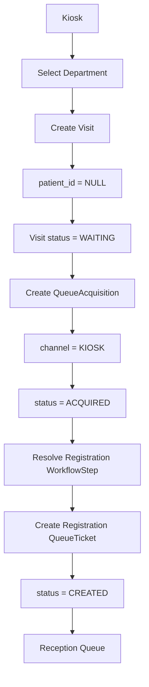

Invariant:

```text
Walk-in Kiosk
    ↓
Visit.patient_id = NULL
    ↓
Visit.status = WAITING
    ↓
Registration QueueTicket = CREATED
```

Kiosk walk-in tidak membuat Patient pada intake awal.

## 8.2 Online Self Check-in melalui Kiosk

Pasien ONLINE sudah memiliki Visit sebelum datang.

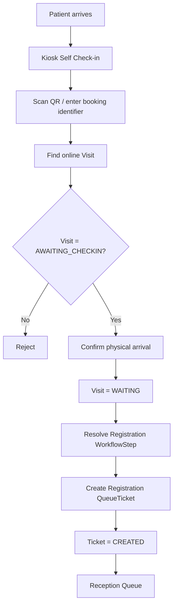

At online booking time:

```text
Visit = AWAITING_CHECKIN
QueueAcquisition = ACQUIRED
NO Registration QueueTicket yet
```

After successful physical check-in:

```text
Visit = WAITING
Registration QueueTicket = CREATED
```

### Important rule

```text
ONLINE BOOKING
    ≠
RECEPTION QUEUE
```

Booking hanya mencatat bahwa pasien memiliki rencana kunjungan.

```text
ONLINE BOOKING
    ↓
AWAITING_CHECKIN
    ↓
Patient physically arrives
    ↓
KIOSK SELF CHECK-IN
    ↓
WAITING
    ↓
RECEPTION QUEUE
```

## 8.3 Online patient tetap melalui reception

Self check-in di kiosk bukan pengganti reception.

Flow fisik pasien online:

```text
Booking online
    ↓
Datang ke klinik
    ↓
Kiosk self check-in
    ↓
Mendapat nomor antrean reception
    ↓
Menunggu
    ↓
Dipanggil receptionist
    ↓
Datang ke meja reception
    ↓
Verification / Registration
    ↓
Clinical Queue
```

Dengan model ini:

```text
Kiosk
    = konfirmasi bahwa pasien sudah datang

Reception
    = proses registrasi pasien
```

## 8.4 Urutan reception

Pasien online baru ikut antrean reception setelah physical check-in.

Karena itu urutan reception tidak berdasarkan waktu booking online.

Contoh:

```text
08:00  Online patient A books
08:10  Online patient B books
08:20  Walk-in patient C arrives
08:25  Patient C creates reception ticket R001
08:30  Patient A arrives and self-checks in → R002
08:35  Patient B has not arrived yet
```

Reception hanya melihat:

```text
R001
R002
```

Pasien B belum masuk antrean reception karena belum melakukan physical check-in.

# 9. Manual Intake Flow

Manual intake dilakukan oleh receptionist.

Flow:

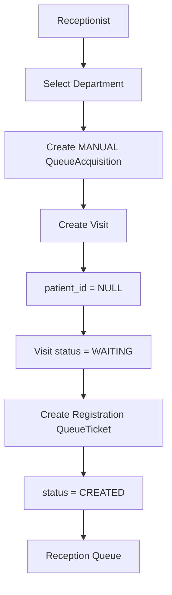

## 9.1 Manual intake invariants

```text
Manual intake
    ↓
NO Patient creation yet
    ↓
Visit.patient_id = NULL
    ↓
Registration QueueTicket = CREATED
```

Patient baru dibuat atau dihubungkan saat registration completion.

---

# 10. Online Intake Flow

Online intake terjadi ketika patient membuat visit sebelum datang secara fisik.

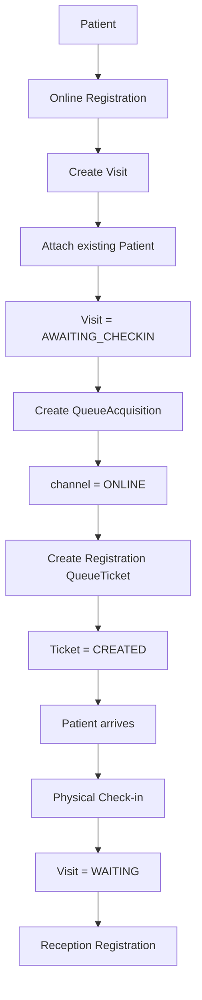

## 10.1 Online rule

Online registration:

```text
Visit.patient_id = existing Patient
Visit.status = AWAITING_CHECKIN
```

Physical check-in:

```text
AWAITING_CHECKIN → WAITING
```

Check-in dan registration completion adalah dua operasi berbeda.

---

# 11. Reception Queue Flow

Semua pasien yang sudah physically present dan membutuhkan registration akan masuk ke reception queue.

Channel menentukan bagaimana pasien mencapai kondisi `WAITING`.

```text
MANUAL
   ↓
Visit = WAITING
   ↓
Registration QueueTicket = CREATED
```

```text
KIOSK WALK-IN
   ↓
Visit = WAITING
   ↓
Registration QueueTicket = CREATED
```

```text
ONLINE
   ↓
Visit = AWAITING_CHECKIN
   ↓
Patient arrives
   ↓
Kiosk Self Check-in
   ↓
Visit = WAITING
   ↓
Registration QueueTicket = CREATED
```

## 11.1 Unified reception flow

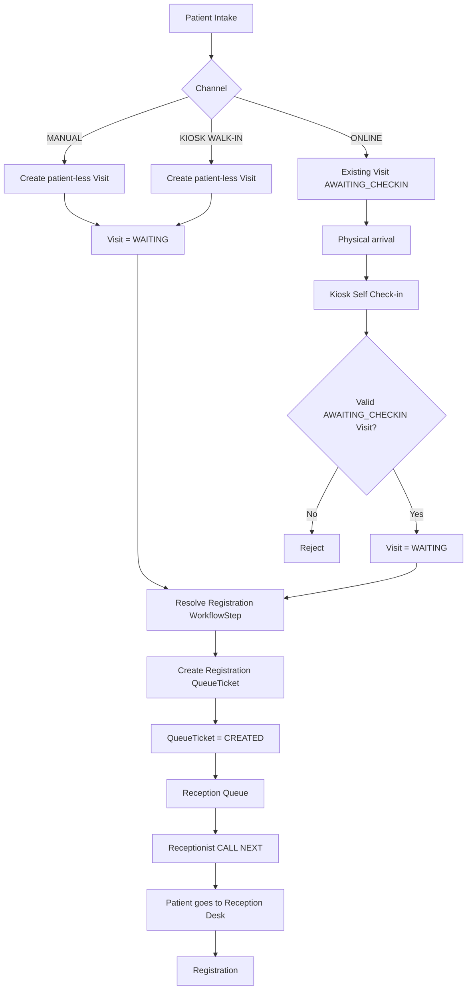

## 11.2 Critical rule

Reception queue hanya berisi pasien yang sudah siap secara fisik untuk dilayani reception.

```text
READY FOR RECEPTION QUEUE
=
patient is physically present
+
Visit = WAITING
+
Registration QueueTicket = CREATED
```

Online booking yang masih:

```text
Visit = AWAITING_CHECKIN
```

tidak boleh muncul sebagai candidate `call-next`.

## 11.3 Reception is still mandatory

Self check-in tidak menghilangkan meja reception.

```text
Kiosk
  ↓
Check-in
  ↓
Reception Queue
  ↓
Receptionist calls
  ↓
Reception Desk
  ↓
Registration
```

Tujuan kiosk adalah menghilangkan proses "lapor sudah datang" secara manual dan memberikan posisi antrian reception secara teratur.

# 12. Registration Completion

Registration completion adalah salah satu operasi bisnis paling penting.

Operasi ini harus diperlakukan sebagai satu kesatuan.

## 12.1 Existing patient

```text
Lock Acquisition
      ↓
Validate ACQUIRED
      ↓
Validate Registration Ticket
      ↓
Attach existing Patient
      ↓
Registration Ticket → COMPLETED
      ↓
QueueAcquisition → REGISTERED
      ↓
Create next clinical QueueTicket
      ↓
Visit remains WAITING
```

## 12.2 New patient

```text
Lock Acquisition
      ↓
Validate ACQUIRED
      ↓
Validate Registration Ticket
      ↓
Create Patient
      ↓
Attach Patient to Visit
      ↓
Registration Ticket → COMPLETED
      ↓
QueueAcquisition → REGISTERED
      ↓
Create next clinical QueueTicket
      ↓
Visit remains WAITING
```

## 12.3 Registration completion state

Set:

```text
Visit.patient_id
Visit.registered_by
Visit.registered_at
```

Final result:

```text
Registration Ticket = COMPLETED
QueueAcquisition = REGISTERED
Next Clinical Ticket = CREATED
Visit = WAITING
```

## 12.4 Registration activity diagram

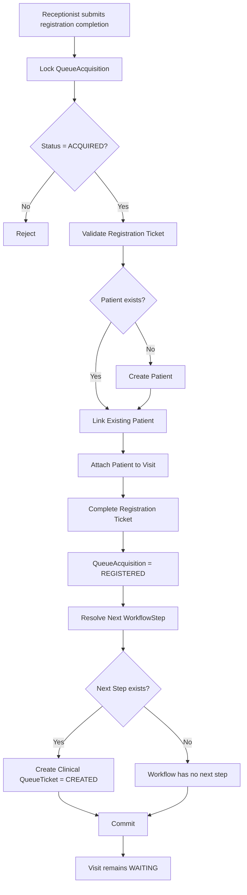

## 12.5 Double-completion protection

Dua request terhadap acquisition yang sama:

```text
Request A → succeeds
Request B → conflict/rejected
```

Result:

```text
one patient attachment
one registration completion
one clinical handoff
```

---

# 13. Workflow Model

Workflow sederhana terdiri dari:

```text
Workflow
   └── WorkflowStep
```

Tidak ada runtime concept tambahan di baseline.

## 13.1 Workflow

Workflow milik sebuah Department.

```text
Department
   └── Workflow
```

Baseline:

```text
one active primary workflow per department
```

## 13.2 WorkflowStep

Konsep:

```text
id
workflow_id
station_id
name
sequence
is_active
is_optional
is_repeatable
can_skip
completion_requirements?
entry_conditions?
created_at
updated_at
```

Urutan step:

```text
WorkflowStep 1
      ↓
WorkflowStep 2
      ↓
WorkflowStep 3
      ↓
...
```

Unique rule:

```text
Workflow + Sequence = UNIQUE
```

## 13.3 Registration step

Jangan menganggap registration selalu `sequence = 1`.

Resolution:

```text
Workflow
  ↓
Active WorkflowSteps
  ↓
Find step whose Station.type = REGISTRATION
```

Harus tepat satu active registration step.

## 13.4 Next workflow step

Setelah QueueTicket selesai:

```text
Current WorkflowStep
       ↓
Find next active WorkflowStep by sequence
       ↓
┌───────────────┴───────────────┐
│                               │
exists                          none
│                               │
Create new                      Visit
QueueTicket                     COMPLETED
```

---

# 14. QueueTicket Model

QueueTicket merupakan lifecycle nyata dari sebuah posisi antrian.

Konsep:

```text
Visit
  │
  ├── QueueTicket 1
  ├── QueueTicket 2
  ├── QueueTicket 3
  └── QueueTicket ...
```

Setiap QueueTicket menunjuk ke:

```text
Visit
WorkflowStep
Station
```

## 14.1 QueueTicket attributes

```text
id
visit_id
workflow_step_id
station_id
queue_number
priority
internal_sequence
status
assigned_to?
transferred_from_ticket_id?
transferred_to_station_id?
notes?
called_at?
started_at?
completed_at?
created_at
updated_at
```

## 14.2 Queue number ownership

Queue number hanya dimiliki QueueTicket.

```text
QueueTicket.queue_number
```

Bukan:

```text
QueueAcquisition.queue_number
```

Satu QueueTicket = satu posisi antrian.

---

# 15. Queue State Machine

QueueTicket lifecycle:

```text
CREATED
CALLED
IN_PROGRESS
ON_HOLD
COMPLETED
SKIPPED
CANCELLED
NO_SHOW
TRANSFERRED
```

## 15.1 Main path

```text
CREATED
   ↓
CALLED
   ↓
IN_PROGRESS
   ↓
COMPLETED
```

## 15.2 Hold path

```text
CALLED ─────→ ON_HOLD
   │              │
   ↓              ↓
IN_PROGRESS ←─────┘
                  ON_HOLD → CALLED
```

Allowed:

```text
CALLED → ON_HOLD
IN_PROGRESS → ON_HOLD
ON_HOLD → CALLED
```

## 15.3 Invalid transition examples

```text
CREATED → COMPLETED         INVALID
COMPLETED → anything        INVALID
```

Semua transition lain yang tidak didefinisikan dianggap invalid.

---

# 16. Queue Event Model

QueueEvent adalah histori, bukan current state.

Current state:

```text
QueueTicket.status
```

History:

```text
QueueEvent
```

Event yang tersedia:

```text
CREATED
CALLED
STARTED
COMPLETED
HELD
RESUMED
SKIPPED
CANCELLED
NO_SHOW
TRANSFERRED
```

Contoh:

```text
QueueTicket
status = IN_PROGRESS

QueueEvents:
  CREATED
  CALLED
  STARTED
```

QueueEvent wajib merepresentasikan perubahan yang benar-benar terjadi.

Tidak boleh membuat event palsu untuk transition yang sebenarnya tidak dilakukan.

---

# 17. Queue Selection

`call-next` memilih QueueTicket yang memenuhi:

```text
station_id = current station
status = CREATED
```

Ordering:

```text
priority DESC
internal_sequence ASC
```

Dengan priority baseline:

```text
EMERGENCY = 3
PRIORITY  = 2
NORMAL    = 1
```

Maka:

```text
EMERGENCY
   ↓
PRIORITY
   ↓
NORMAL
```

Untuk priority yang sama:

```text
first created sequence
   ↓
next sequence
   ↓
next sequence
```

## 17.1 ON_HOLD

`ON_HOLD` tidak termasuk candidate `call-next`.

```text
call-next
   X
ON_HOLD
```

Pasien hold hanya kembali melalui operasi resume.

---

# 18. Queue Call Activity

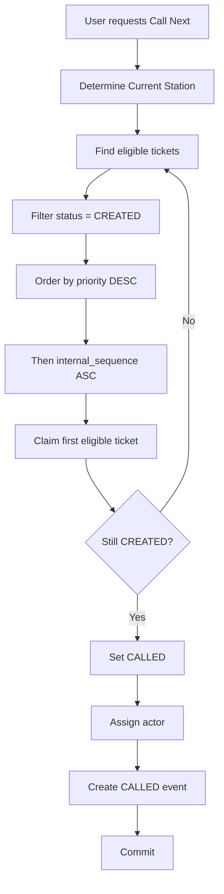

Concurrency invariant:

```text
10 simultaneous requests
        +
1 eligible ticket
        ↓
1 request claims it
9 requests do not claim the same ticket
```

---

# 19. Queue Numbering Model

Queue numbering adalah nomor yang terlihat pada antrian.

Station menentukan prefix.

Contoh:

```text
A001
A002
A003
A004
...
A1000
```

Minimal padding:

```text
3 digit
```

Tetapi tidak ada batas maksimum 999.

## 19.1 QueueCounter

Konsep:

```text
station_id
counter_date
last_sequence
```

Uniqueness:

```text
station + date
```

Artinya setiap station memiliki counter sendiri setiap tanggal.

Contoh:

```text
Registration A — 2026-09-24
A001
A002
A003

Registration B — 2026-09-24
B001
B002
B003
```

## 19.2 Gap rule

Queue number tidak harus gapless.

Contoh:

```text
A001
A002
transaction rollback
A004
```

Gap diperbolehkan.

Yang wajib:

```text
No duplicate committed number
```

---

# 20. Visit Number

Visit juga mempunyai sequence counter terpisah:

```text
VisitCounter
   └── counter_date
        └── last_sequence
```

Uniqueness:

```text
counter_date
```

Queue counter dan Visit counter adalah dua mekanisme yang berbeda.

---

# 21. Priority Model

Priority adalah snapshot pada QueueTicket.

Baseline:

```text
NORMAL = 1
PRIORITY = 2
EMERGENCY = 3
```

Queue ordering:

```text
priority DESC
internal_sequence ASC
```

## 21.1 Priority propagation

Jika priority Visit berubah:

```text
Visit.priority = new priority
```

Propagasikan hanya ke ticket aktif/pending:

```text
CREATED
CALLED
ON_HOLD
```

Jangan mengubah historical ticket:

```text
COMPLETED
SKIPPED
CANCELLED
NO_SHOW
TRANSFERRED
```

Dengan demikian:

```text
historical queue history
        ≠
current priority snapshot
```

---

# 22. Clinical Queue Flow

Setelah registration selesai:

```text
Registration Ticket
       ↓
COMPLETED
       ↓
Resolve next WorkflowStep
       ↓
Create Clinical QueueTicket
       ↓
CREATED
       ↓
Station Queue
```

Clinical lifecycle:

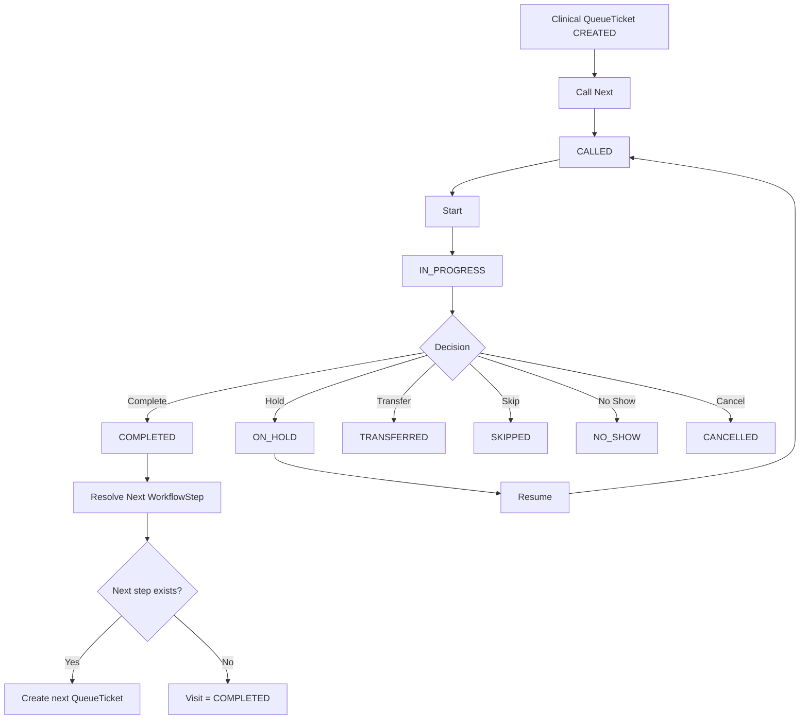

---

# 23. Clinical Service Start

Saat clinical service benar-benar dimulai:

```text
QueueTicket
    CALLED
       ↓
    IN_PROGRESS
```

Pada titik ini:

```text
Visit
    WAITING
       ↓
    IN_PROGRESS
```

### Important boundary

Queue state machine bertanggung jawab terhadap QueueTicket.

Tetapi perubahan global Visit:

```text
WAITING → IN_PROGRESS
```

ditangani secara eksplisit oleh business service ketika clinical service dimulai.

Jangan mengubah Visit menjadi `IN_PROGRESS` saat:

```text
Reception registration completes
```

---

# 24. Clinical Completion

Saat QueueTicket selesai:

```text
QueueTicket
    IN_PROGRESS
       ↓
    COMPLETED
```

Kemudian:

```text
Find next active WorkflowStep
```

### Bila ada next step

```text
Create QueueTicket
      ↓
status = CREATED
```

### Bila tidak ada next step

```text
Visit
   ↓
COMPLETED
```

---

# 25. Transfer Model

Transfer berbeda dari referral.

## 25.1 Transfer definition

Transfer:

```text
same Visit
same WorkflowStep
different Station
```

Visual:

```text
Station A
   │
   └── QueueTicket A
            │
         TRANSFER
            │
            ↓
Station B
   │
   └── QueueTicket B
```

## 25.2 Transfer transaction

```text
Old QueueTicket
     ↓
TRANSFERRED

+

New QueueTicket
     ↓
CREATED
```

Old ticket menjadi histori.

New ticket menjadi posisi aktif.

## 25.3 Transfer rules

Target station harus:

```text
active
same department
compatible with current workflow step
```

Pada baseline, compatibility:

```text
same department
AND
same station type as workflow step's declared station
```

Transfer tidak mengubah definition WorkflowStep.

---

# 26. Transfer Activity Diagram

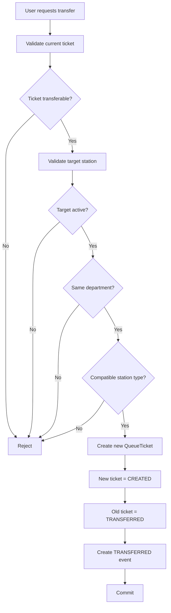

Concurrent transfer terhadap ticket yang sama:

```text
Request A → succeeds
Request B → rejected
```

---

# 27. Referral Model

Referral berbeda secara semantik dari transfer.

## 27.1 Transfer

```text
Same Visit
Same WorkflowStep
Different Station
```

## 27.2 Referral

```text
Source Visit
     ↓
Target Department
     ↓
Target Visit
     ↓
Target Workflow
     ↓
Target QueueTicket
```

Referral dapat menghasilkan Visit baru pada department tujuan.

## 27.3 Referral attributes

```text
source_visit_id
target_department_id
target_visit_id?
referred_by_user_id
status
priority
reason
created_at
updated_at
```

---

# 28. Referral Flow

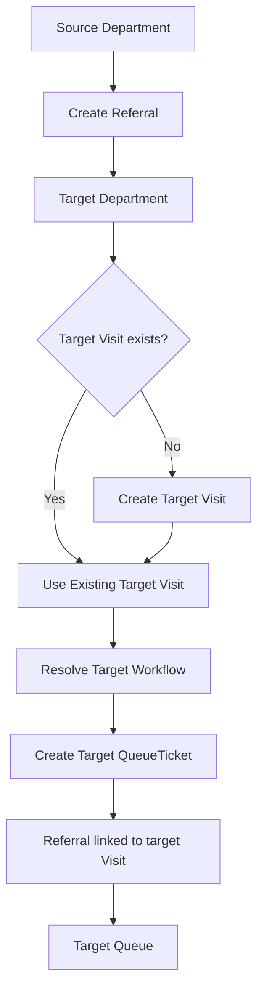

Referral menggunakan transaksi ketika beberapa record harus dibuat/diubah sebagai satu business operation.

---

# 29. Audit Log

AuditLog digunakan untuk perubahan bisnis/admin penting.

Contoh:

```text
Priority change
Referral
Administrative modification
Sensitive state changes
```

Bukan untuk setiap read operation.

Konsep:

```text
user_id?
action
entity_type
entity_id
metadata?
ip_address?
created_at
```

AuditLog menjawab:

```text
Who
What
On which resource
When
With what relevant context
```

---

# 30. Data Relationship / ERD

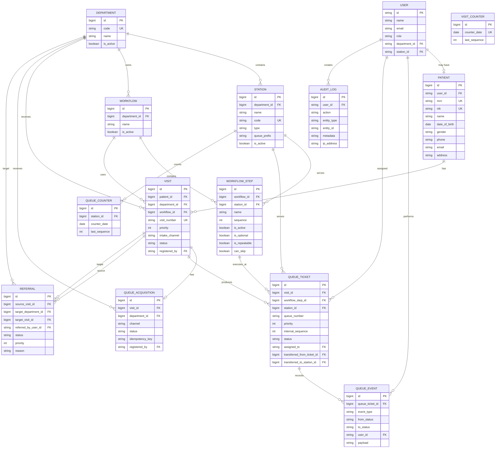

---

# 31. Simplified ERD for AI Agents

Bila AI agent membutuhkan gambaran tercepat, gunakan model berikut:

```text
                    ┌──────────────┐
                    │   PATIENT    │
                    └──────┬───────┘
                           │
                           │ 1:N
                           ▼
                    ┌──────────────┐
                    │     VISIT    │
                    └──────┬───────┘
                           │
             ┌─────────────┼─────────────┐
             │             │             │
             ▼             ▼             ▼
      ┌────────────┐ ┌────────────┐ ┌──────────────┐
      │  DEPARTMENT│ │  WORKFLOW  │ │ ACQUISITION  │
      └─────┬──────┘ └─────┬──────┘ └──────────────┘
            │              │
            │              ▼
            │       ┌──────────────┐
            │       │ WORKFLOW STEP│
            │       └──────┬───────┘
            │              │
            ▼              ▼
      ┌────────────┐  ┌──────────────┐
      │   STATION  │◄─│ QUEUE TICKET │
      └────────────┘  └──────┬───────┘
                              │
                              ▼
                       ┌─────────────┐
                       │ QUEUE EVENT │
                       └─────────────┘
```

---

# 32. End-to-End Patient Journey

## 32.1 Kiosk Walk-in Journey

```text
Kiosk
  ↓
Select Department
  ↓
Patient-less Visit
  ↓
Visit = WAITING
  ↓
QueueAcquisition = ACQUIRED
  ↓
Registration Ticket = CREATED
  ↓
Reception CALL
  ↓
Patient goes to Reception Desk
  ↓
Patient create/link
  ↓
Registration complete
  ↓
Clinical Queue
```

## 32.2 Manual Journey

```text
Receptionist selects Department
  ↓
Create MANUAL acquisition
  ↓
patient_id = NULL
  ↓
Visit = WAITING
  ↓
Registration Ticket = CREATED
  ↓
Reception CALL
  ↓
Patient create/link
  ↓
Complete registration
  ↓
Clinical Queue
```

## 32.3 Online Journey

```text
Patient
  ↓
Online booking
  ↓
Existing Patient linked
  ↓
Visit = AWAITING_CHECKIN
  ↓
QueueAcquisition = ACQUIRED
  ↓
NO reception QueueTicket yet
  ↓
Patient arrives at clinic
  ↓
Kiosk Self Check-in
  ↓
Validate online Visit
  ↓
Visit = WAITING
  ↓
Create Registration QueueTicket
  ↓
Reception Queue
  ↓
Reception CALL
  ↓
Patient goes to Reception Desk
  ↓
Registration / Verification
  ↓
Clinical Queue
```

## 32.4 Online sequence diagram

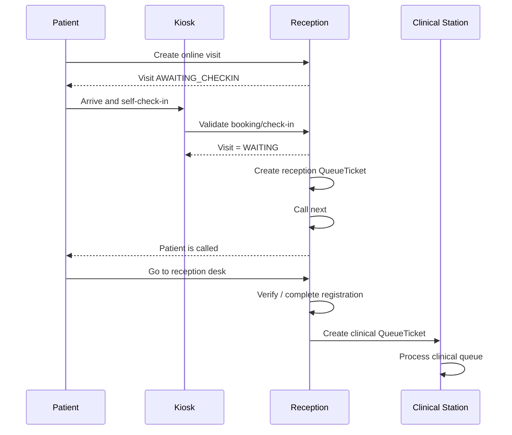

## 32.5 Kiosk self check-in must not bypass reception

```text
ONLINE PATIENT

Kiosk
  ↓
Reception Queue
  ↓
Receptionist
  ↓
Reception Desk
  ↓
Registration
  ↓
Clinical Queue
```

The kiosk only changes how the patient enters the reception queue.

# 33. Main System Activity Diagram

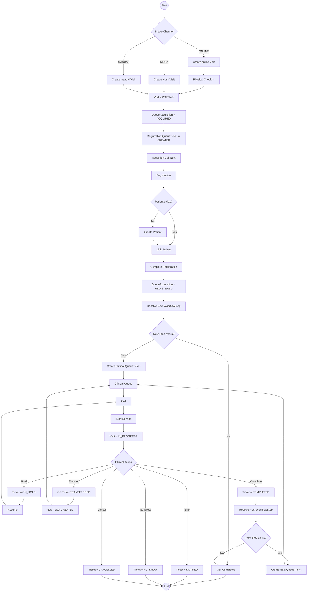

---

# 34. Queue State Activity Diagram

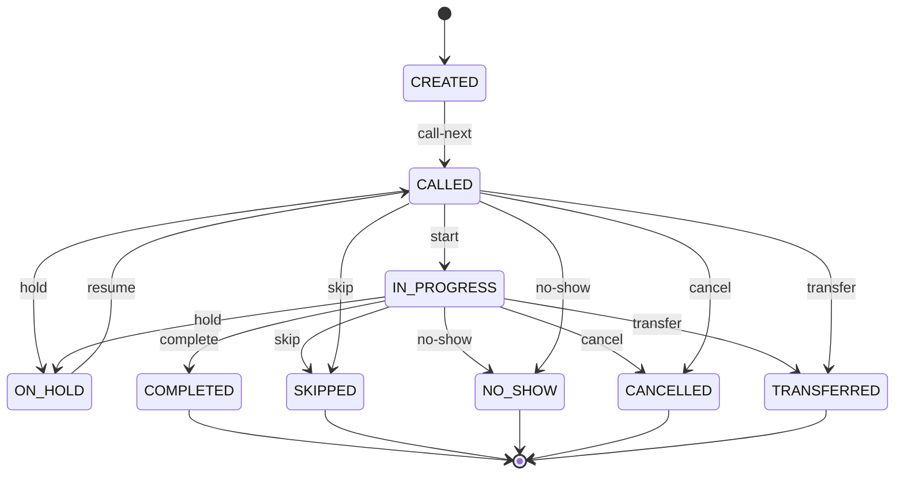

> Transition yang benar-benar diizinkan harus selalu ditentukan oleh business rule/state machine. Diagram ini menggambarkan lifecycle baseline dan bukan izin otomatis untuk menambahkan transition baru.

---

# 35. Visit State Activity Diagram

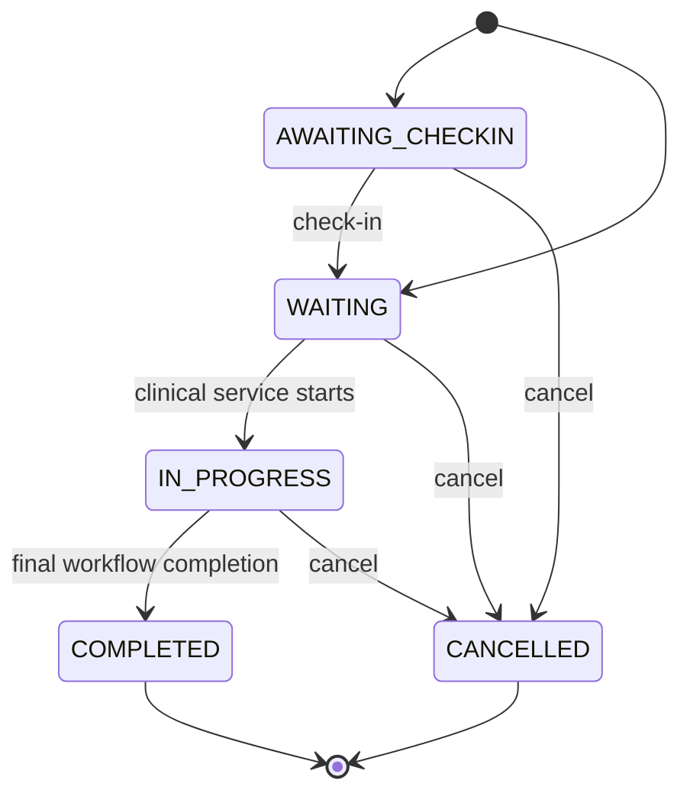

---

# 36. State Ownership

Setiap entity memiliki lifecycle sendiri.

| Entity | Current state authority |
|---|---|
| Visit | Visit lifecycle |
| QueueAcquisition | Acquisition lifecycle |
| QueueTicket | Queue lifecycle |
| QueueEvent | Historical event only |
| Referral | Referral lifecycle |
| Patient | Patient identity, bukan queue state |

### Critical separation

```text
Visit.status
    ≠
QueueAcquisition.status
    ≠
QueueTicket.status
```

Online visit menambahkan satu important distinction:

```text
AWAITING_CHECKIN
    =
booking exists, patient has not confirmed physical arrival

WAITING
    =
patient is physically present and ready to enter reception flow
```

Untuk online patient:

```text
ONLINE BOOKING
    ↓
Visit = AWAITING_CHECKIN
    ↓
Kiosk Self Check-in
    ↓
Visit = WAITING
    ↓
Create Reception QueueTicket
```

Tidak boleh membuat reception QueueTicket yang eligible `call-next` sebelum physical check-in berhasil.

# 37. Critical Business Invariants

AI agent **harus menjaga invariant berikut**.

## Identity & Patient

```text
1. Patient tidak wajib memiliki User account.
2. User tidak otomatis merupakan Patient.
3. Public patient creation tidak boleh membuat privileged user.
```

## Intake

```text
4. MANUAL tidak langsung membuat Patient.
5. KIOSK tidak langsung membuat Patient.
6. ONLINE menghubungkan existing Patient.
7. QueueAcquisition hanya untuk intake/reception.
```

## Reception

```text
8. Receptionist memilih Department.
9. Backend menentukan Registration Station.
10. Client tidak boleh menjadi authority untuk station.
11. Registration completion adalah atomic business operation.
12. Registration completion tidak mengubah Visit menjadi IN_PROGRESS.
13. Registration completion menghasilkan clinical handoff bila next step tersedia.
```

## Workflow

```text
14. Workflow terdiri dari Workflow + WorkflowStep.
15. Registration step ditentukan berdasarkan Station.type = REGISTRATION.
16. Tidak boleh ada zero/multiple active registration step.
17. Next step ditentukan berdasarkan sequence active step.
```

## Queue

```text
18. QueueTicket memiliki lifecycle queue.
19. Queue number hanya milik QueueTicket.
20. call-next hanya mengambil CREATED.
21. ON_HOLD tidak dipilih call-next.
22. Queue ordering = priority DESC + internal_sequence ASC.
23. Historical ticket tidak diubah ketika priority berubah.
```

## Concurrency

```text
24. call-next harus mencegah duplicate claim.
25. queue numbering harus mencegah duplicate number.
26. registration completion harus mencegah double completion.
27. transfer harus mencegah double transfer.
```

## Transfer vs Referral

```text
28. Transfer ≠ Referral.
29. Transfer mempertahankan Visit dan WorkflowStep.
30. Referral berpindah ke target Department dan dapat membuat target Visit.
```

## Security / Authorization

```text
31. Authentication dan authorization adalah konsep berbeda.
32. Authorization tidak boleh hanya berdasarkan role.
33. Authorization mempertimbangkan Department, Station, Resource, State, dan business rules.
34. Patient hanya dapat melihat resource miliknya.
35. Public queue tidak boleh membocorkan PII.
```

---

# 38. Transaction Boundaries

Beberapa operasi harus dipandang sebagai satu business transaction.

## Intake

```text
Visit
+
QueueAcquisition
+
Registration QueueTicket
```

## Reception Completion

```text
Patient create/link
+
Visit update
+
Registration ticket completion
+
Acquisition update
+
Workflow advancement
+
Next QueueTicket
```

## Transfer

```text
Old Ticket → TRANSFERRED
+
New Ticket → CREATED
```

## Referral

```text
Referral
+
Target Visit if needed
+
Target QueueTicket
```

Prinsip bisnis:

```text
Either the complete operation succeeds,
or the business state must not be partially committed.
```

---

# 39. Idempotency Rules

QueueAcquisition memiliki konsep `idempotency_key`.

Behavior:

```text
Same key
+
Equivalent request
=
Return original operation result
```

Sedangkan:

```text
Same key
+
Conflicting request
=
409 Conflict
```

Idempotency scope harus konsisten.

---

# 40. Authorization Matrix

Matrix berikut menggambarkan capability level, bukan implementasi endpoint.

| Operation | Patient | Receptionist | Clinical User | Administrator |
|---|---:|---:|---:|---:|
| Create online visit | ✓ | — | — | — |
| Check-in own visit | ✓ | ✓* | — | ✓* |
| Create manual intake | — | ✓ | — | ✓ |
| Create kiosk intake | — | — | — | ✓* |
| Call reception queue | — | ✓ | — | ✓ |
| Complete registration | — | ✓ | — | ✓* |
| Call clinical queue | — | — | ✓ | ✓ |
| Start ticket | — | — | ✓ | ✓ |
| Complete ticket | — | — | ✓ | ✓ |
| Hold ticket | — | — | ✓ | ✓ |
| Resume ticket | — | — | ✓ | ✓ |
| Transfer ticket | — | — | ✓* | ✓ |
| Change priority | — | — | ✓* | ✓ |
| Create referral | — | — | ✓ | ✓ |
| View own visit | ✓ | — | — | ✓ |
| View public queue | ✓ | ✓ | ✓ | ✓ |

`*` berarti capability bergantung pada policy/context/resource/business rules.

### Critical principle

Role alone is insufficient.

Contoh:

```text
Clinical User
    ≠
Can manipulate every QueueTicket
```

Yang benar:

```text
Clinical User
 +
Assigned Department
 +
Assigned Station
 +
Ticket Station
 +
Ticket State
 +
Operation Policy
```

---

# 41. Workstation Context Rules

## Reception

```text
Receptionist selects Department
        ↓
Server validates department access
        ↓
Server finds active Registration Station
        ↓
Station becomes authoritative context
```

Client-provided station:

```text
untrusted hint
```

Bukan source of truth.

## Clinical

Clinical context berasal dari assignment user:

```text
user.department_id
user.station_id
```

System validates:

```text
assigned station exists
station active
station belongs to department
ticket.station = assigned station
```

---

# 42. Public Queue Design

Public queue hanya membutuhkan data untuk display.

Allowed concept:

```text
Station
Queue Number
Queue Status / Display State
Relevant queue position information
```

Forbidden:

```text
Patient name
NIK
MRN
Phone
Email
Address
Medical information
User ID
Internal audit data
```

Prinsip:

```text
Public display
    ↓
Minimum necessary information
```

---

# 43. Queue & Visit History Example

Contoh satu pasien:

```text
Patient
   │
   └── Visit #20260924-001
          │
          ├── QueueTicket R001
          │      WorkflowStep: Registration
          │      Status: COMPLETED
          │
          ├── QueueTicket N001
          │      WorkflowStep: Nurse
          │      Status: COMPLETED
          │
          └── QueueTicket D001
                 WorkflowStep: Doctor
                 Status: IN_PROGRESS
```

Visit tetap satu:

```text
Visit #20260924-001
```

Tetapi queue ticket dapat bertambah sesuai perjalanan workflow.

---

# 44. Transfer Example

Satu Visit:

```text
Visit #001
```

WorkflowStep:

```text
Doctor Consultation
```

Awalnya:

```text
Doctor Station A
QueueTicket A001
IN_PROGRESS
```

Kemudian transfer:

```text
A001 → TRANSFERRED
```

Ticket baru:

```text
Doctor Station B
QueueTicket B001
CREATED
```

Yang berubah:

```text
Station
QueueTicket
```

Yang tidak berubah:

```text
Visit
Workflow
WorkflowStep
```

---

# 45. Referral Example

Pasien menyelesaikan pelayanan di:

```text
Department A
```

Kemudian membutuhkan pelayanan:

```text
Department B
```

Flow:

```text
Visit A
   ↓
Referral
   ↓
Department B
   ↓
Target Visit B
   ↓
Target Workflow
   ↓
Target QueueTicket
```

Referral menghasilkan hubungan antar perjalanan pelayanan.

---

# 46. Error / Conflict Business Cases

Business layer harus dapat membedakan kondisi berikut:

```text
Unauthenticated
Forbidden
Not Found
Validation Error
Invalid State
Conflict
```

Contoh conflict:

```text
Queue already claimed
Registration already completed
Transfer already completed
Idempotency conflict
```

Contoh forbidden:

```text
User does not have access to Department
User does not have access to Station
```

Contoh invalid state:

```text
CREATED → COMPLETED
COMPLETED → IN_PROGRESS
```

---

# 47. Concurrency Scenarios

## 47.1 Two users call next

```text
Ticket X = CREATED

User A → Call Next
User B → Call Next
```

Expected:

```text
A → CALLED
B → does not claim X
```

Tidak boleh:

```text
A → CALLED X
B → CALLED X
```

## 47.2 Concurrent numbering

```text
50 concurrent requests
```

Expected:

```text
no duplicate queue number
no duplicate committed internal sequence
```

Rollback boleh menghasilkan gap.

## 47.3 Concurrent registration completion

```text
Request A → complete acquisition X
Request B → complete acquisition X
```

Expected:

```text
one succeeds
one rejected
```

## 47.4 Concurrent transfer

```text
Request A → transfer ticket X
Request B → transfer ticket X
```

Expected:

```text
one succeeds
one rejected
```

---

# 48. End-to-End Scenarios

## Scenario A — Kiosk

```text
Kiosk
  ↓
Patient-less Visit
  ↓
QueueAcquisition = ACQUIRED
  ↓
Registration Ticket = CREATED
  ↓
Reception CALL
  ↓
Patient create/link
  ↓
Registration Ticket = COMPLETED
  ↓
QueueAcquisition = REGISTERED
  ↓
Clinical Ticket = CREATED
  ↓
Clinical START
  ↓
Visit = IN_PROGRESS
  ↓
Clinical COMPLETE
  ↓
Next step OR Visit = COMPLETED
```

## Scenario B — Manual

```text
Reception selects Department
  ↓
Create MANUAL acquisition
  ↓
patient_id = NULL
  ↓
Reception CALL
  ↓
Create/link Patient
  ↓
Complete registration
  ↓
Clinical Queue
```

## Scenario C — Online

```text
Online booking
  ↓
Existing Patient linked
  ↓
Visit = AWAITING_CHECKIN
  ↓
No reception QueueTicket yet
  ↓
Patient arrives at clinic
  ↓
Kiosk Self Check-in
  ↓
Visit = WAITING
  ↓
Create Reception QueueTicket = CREATED
  ↓
Reception CALL
  ↓
Patient goes to Reception Desk
  ↓
Reception registration
  ↓
Clinical Queue
```

## Scenario D — Transfer

```text
Station A
  ↓
Transfer
  ↓
Old Ticket = TRANSFERRED
  ↓
New Ticket = CREATED
  ↓
Station B
```

## Scenario E — Referral

```text
Department A
  ↓
Referral
  ↓
Department B
  ↓
Target Visit
  ↓
Target Queue
```

---

# 49. AI Agent Guardrails

Sebelum mengubah domain logic, AI agent harus memahami:

```text
1. Visit bukan QueueTicket.
2. QueueAcquisition bukan QueueTicket.
3. QueueAcquisition hanya lifecycle intake.
4. QueueTicket adalah lifecycle antrian.
5. QueueEvent hanya history.
6. Queue number hanya dimiliki QueueTicket.
7. Receptionist memilih Department, server menentukan Registration Station.
8. Client tidak pernah menjadi authority untuk station.
9. MANUAL/KIOSK walk-in tidak membuat Patient saat intake awal.
10. ONLINE sudah memiliki Patient.
11. Online booking tidak membuat reception QueueTicket yang eligible dipanggil.
12. Pasien ONLINE harus physical check-in melalui kiosk sebelum masuk reception queue.
13. Pasien ONLINE tetap dipanggil dan dilayani di meja reception.
14. Registration completion tidak membuat Visit IN_PROGRESS.
15. Clinical start yang membuat Visit menjadi IN_PROGRESS.
16. ON_HOLD tidak dipanggil oleh call-next.
17. Priority ordering = priority DESC + internal_sequence ASC.
18. Transfer berbeda dari referral.
19. Transfer mempertahankan Visit dan WorkflowStep.
20. Referral berpindah ke target Department.
21. Historical ticket tidak boleh berubah hanya karena priority Visit berubah.
22. Critical multi-record operation harus atomic.
23. Concurrency harus dianggap sebagai business requirement.
24. Authorization tidak cukup dengan role.
25. Patient hanya boleh membaca resource miliknya.
26. Public queue tidak boleh membocorkan PII.
27. Jangan menambah domain abstraction tanpa business requirement konkret.
28. Bila requirement tidak jelas, jangan mengarang behavior.
```

# 50. Domain Glossary

| Term | Meaning |
|---|---|
| Patient | Identitas pasien dalam domain |
| Visit | Satu kunjungan ke satu department |
| Department | Unit pelayanan |
| Station | Titik pelayanan |
| Workflow | Urutan proses pelayanan |
| WorkflowStep | Satu tahap workflow |
| QueueAcquisition | Intake menuju reception |
| QueueTicket | Posisi antrian untuk satu workflow step |
| QueueEvent | Riwayat perubahan QueueTicket |
| QueueCounter | Counter nomor antrian per station per tanggal |
| VisitCounter | Counter nomor visit per tanggal |
| Registration | Proses menghubungkan Visit dengan Patient dan menyelesaikan intake |
| Transfer | Pemindahan QueueTicket ke station lain pada Visit dan WorkflowStep yang sama |
| Referral | Pengalihan pelayanan ke department lain melalui target Visit |
| Priority | Tingkat urgensi queue |
| Workstation context | Department/station context tempat user bekerja |

---

# 51. Design Invariants — Compact Reference

Gunakan blok berikut sebagai referensi paling cepat untuk AI agent:

```text
DOMAIN

Patient
    ↓
Visit
    ↓
QueueTicket(s)

Visit
    ├── Department
    ├── Workflow
    ├── QueueAcquisition
    └── QueueTicket(s)

QueueTicket
    ├── WorkflowStep
    ├── Station
    ├── Queue Number
    ├── Priority
    └── Queue Status


INTAKE

ONLINE
    → Patient already known
    → Visit AWAITING_CHECKIN
    → Arrives at clinic
    → Kiosk self check-in
    → Visit WAITING
    → Create Reception QueueTicket

KIOSK
    → Patient unknown
    → Visit patient_id NULL
    → WAITING

MANUAL
    → Patient unknown
    → Visit patient_id NULL
    → WAITING


RECEPTION

Department selected/resolved for reception flow
    ↓
Registration station resolved
    ↓
Patient must be physically present
    ↓
Registration QueueTicket = CREATED
    ↓
Reception CALL NEXT
    ↓
Patient goes to Reception Desk
    ↓
Patient create/link
    ↓
Registration complete
    ↓
Acquisition REGISTERED
    ↓
Next QueueTicket CREATED
    ↓
Visit remains WAITING

ONLINE EXCEPTION

Online booking
    ↓
Visit = AWAITING_CHECKIN
    ↓
No reception QueueTicket yet
    ↓
Kiosk self check-in
    ↓
Visit = WAITING
    ↓
Create Registration QueueTicket


CLINICAL

CREATED
   ↓
CALLED
   ↓
IN_PROGRESS
   ↓
COMPLETED
   ↓
Next WorkflowStep
   OR
Visit COMPLETED


QUEUE SELECTION

Eligible:
    station matches
    status = CREATED

Ordering:
    priority DESC
    internal_sequence ASC

ON_HOLD:
    excluded from call-next


TRANSFER

same Visit
same WorkflowStep
different Station

old ticket → TRANSFERRED
new ticket → CREATED


REFERRAL

source Visit
    ↓
target Department
    ↓
target Visit
    ↓
target Workflow
    ↓
target QueueTicket


SECURITY

Authorization =
    Role
    + Department
    + Station
    + Resource
    + State
    + Business Rule

Public Queue:
    no PII


CONCURRENCY

call-next:
    one ticket → one successful claim

registration:
    one acquisition → one completion

transfer:
    one active ticket → one successful transfer

numbering:
    committed queue numbers must be unique
```

---

# 52. Design Boundary

Dokumen ini berfokus pada:

```text
Actor
Role
Department
Station
Patient
Visit
QueueAcquisition
QueueTicket
Workflow
WorkflowStep
QueueEvent
Priority
Transfer
Referral
Audit
State transition
Authorization context
Business invariants
Concurrency invariants
Patient journey
```

Gunakan dokumen ini untuk memahami:

```text
Apa yang terjadi
Siapa yang dapat melakukan
Kapan state berubah
Apa hubungan antar-entitas
Apa aturan bisnisnya
Apa kondisi yang harus selalu benar
```

Jangan menggunakan dokumen ini untuk menentukan detail implementasi. Detail implementasi harus mengikuti domain behavior yang telah didefinisikan di sini.

---

# 53. Decision Boundary / Open Questions

Jangan mengarang behavior baru pada area yang belum didefinisikan.

Area yang masih membutuhkan explicit business decision:

```text
1. Daftar final role klinis dan permission detail setiap role.
2. Detail permission Administrator.
3. Aturan cancel Visit pada setiap tahap.
4. Aturan skip/no-show terhadap workflow advancement.
5. Detail optional/repeatable WorkflowStep behavior.
6. Detail referral status lifecycle.
7. Detail priority change permission per role.
8. Apakah satu user dapat bekerja pada banyak station.
9. Apakah satu WorkflowStep dapat dilayani oleh banyak station.
10. Aturan transfer yang lebih granular bila compatibility station membutuhkan whitelist.
```

Jika requirement baru muncul:

```text
Requirement baru
      ↓
Apakah sudah didefinisikan?
      ├── YES → ikuti specification
      └── NO  → dokumentasikan decision
                sebelum mengubah domain behavior
```

---

# 54. Final System Picture

```text
                         KIYU

        ┌────────────────────────────────┐
        │          INTAKE CHANNELS        │
        │                                │
        │   ONLINE   KIOSK   MANUAL      │
        └──────────────┬─────────────────┘
                       │
          ┌────────────┼────────────┐
          │            │            │
          ▼            ▼            ▼
      AWAITING      WAITING      WAITING
      CHECK-IN       │              │
          │          │              │
          ▼          │              │
      KIOSK          │              │
   SELF CHECK-IN     │              │
          │          │              │
          └──────────┴──────────────┘
                     │
                     ▼
              Reception Queue
                     │
                     ▼
              Reception CALL
                     │
                     ▼
              Reception Desk
                     │
                     ▼
                 Registration
                     │
                     ▼
                  WORKFLOW
                     │
                     ▼
              Clinical Queue(s)
                     │
                     ▼
              Visit COMPLETED
```

## Online-specific flow

```text
Online Booking
      ↓
Visit = AWAITING_CHECKIN
      ↓
Patient arrives
      ↓
Kiosk Self Check-in
      ↓
Visit = WAITING
      ↓
Create Registration QueueTicket
      ↓
Reception Queue
      ↓
Reception CALL NEXT
      ↓
Reception Desk
      ↓
Registration
      ↓
Clinical Queue
```

### Important conceptual distinction

```text
Booking
    = intent / scheduled visit

Physical Check-in
    = patient confirms arrival

Reception Queue
    = patient is physically present and waiting for reception

Reception Registration
    = staff verifies/completes registration

Clinical Queue
    = patient waits for clinical service
```

# 55. Final Rules

```text
1. Business domain comes before implementation details.
2. Visit represents the patient visit.
3. QueueAcquisition represents reception intake.
4. QueueTicket represents a queue position for one workflow step.
5. Workflow defines the service sequence.
6. WorkflowStep defines one stage and its station.
7. QueueEvent is history, not current state.
8. Reception registration is an explicit business boundary.
9. Manual/Kiosk walk-in does not create Patient at initial intake.
10. Online patient identity exists before physical arrival.
11. Online booking does not create a reception QueueTicket that is eligible for call-next.
12. ONLINE patient must physically check in through kiosk self check-in before entering reception queue.
13. ONLINE patient still goes to the reception desk after being called.
14. Registration completion does not make Visit IN_PROGRESS.
15. Clinical service start is what makes Visit IN_PROGRESS.
16. Queue selection is priority-aware and FIFO within priority.
17. ON_HOLD is not selected by call-next.
18. Queue numbers are station/date scoped.
19. Queue numbers do not need to be gapless.
20. Transfer changes station within the same Visit + WorkflowStep.
21. Referral changes Department and may create another Visit.
22. Historical queue records must remain historically accurate.
23. Critical operations must be atomic.
24. Concurrency is part of correctness, not merely performance.
25. Authorization must be contextual.
26. Public queue must expose minimum necessary data.
27. Do not add abstractions without a concrete business need.
28. Unknown requirements must be documented instead of invented.
```

**End of KIYU System Design Specification**

**End of KIYU System Design Specification**
